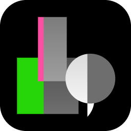
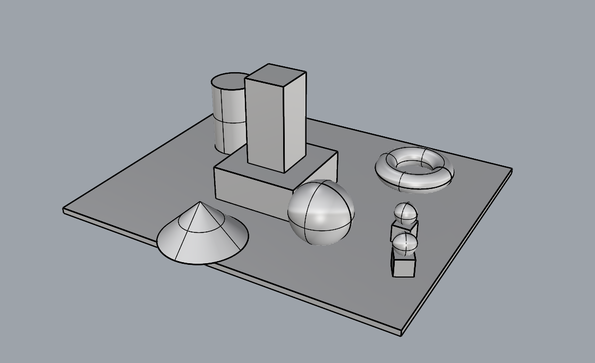
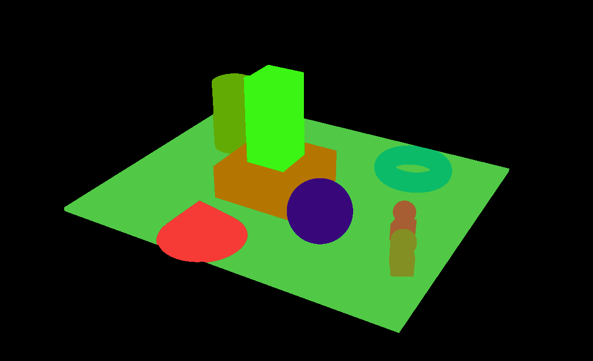
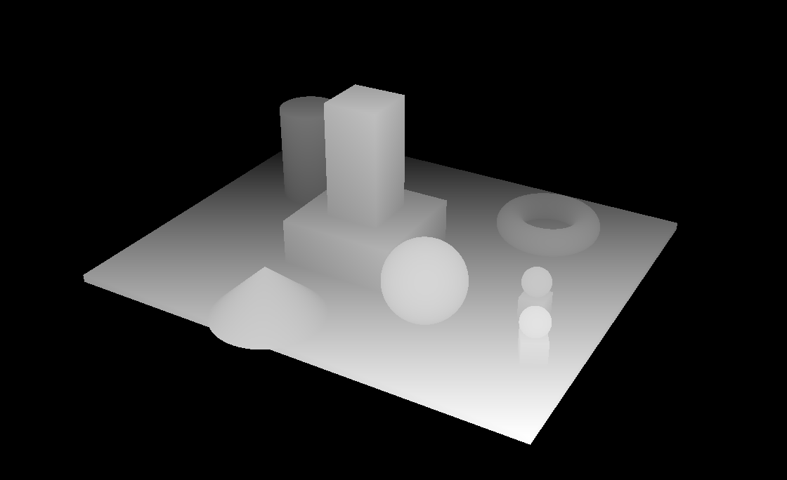
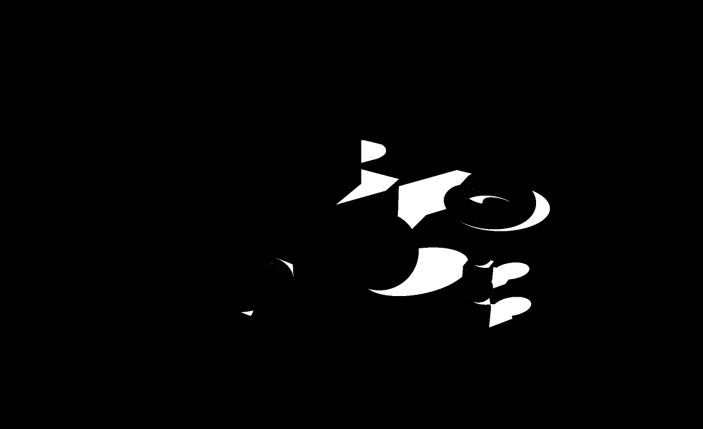
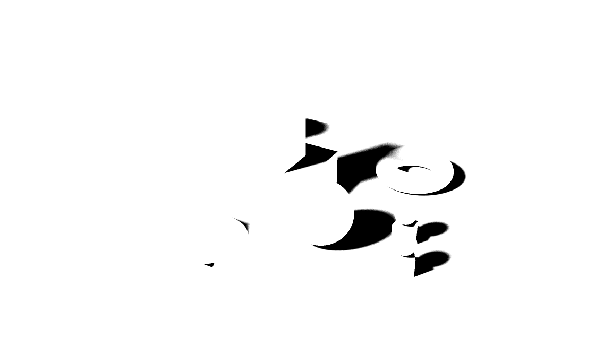
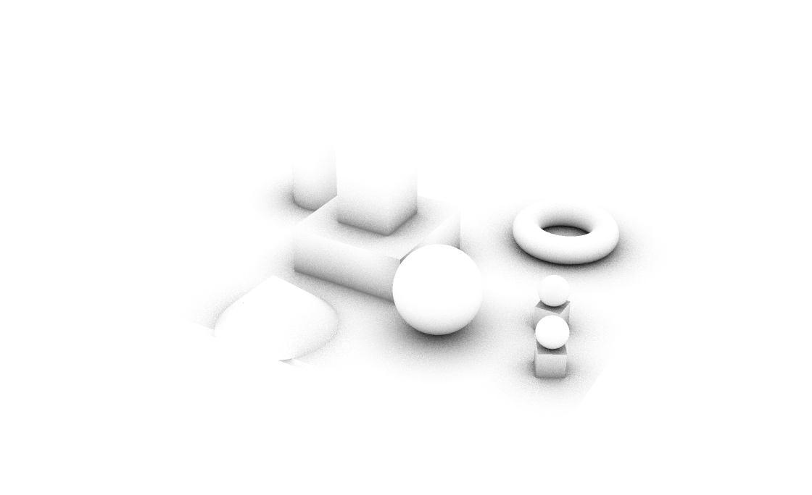
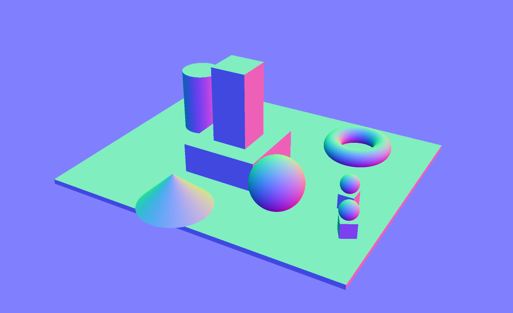
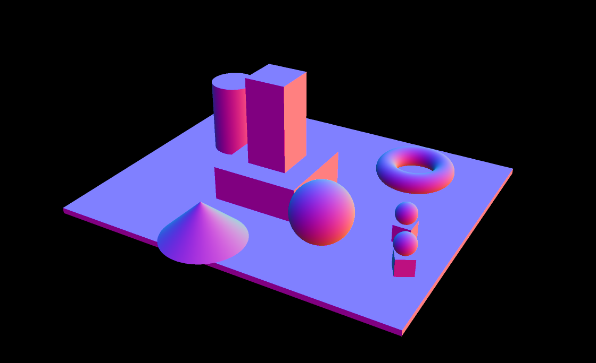
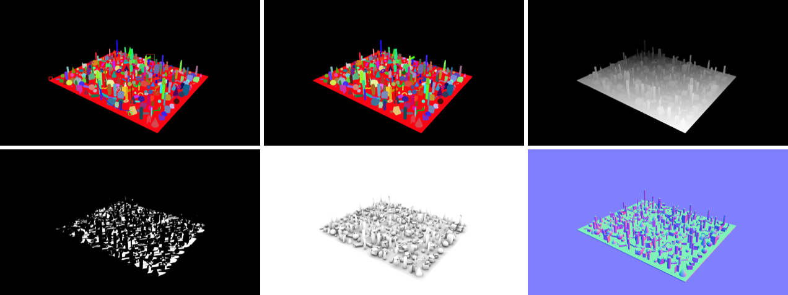

# ImgTools



ImgTools plug-in for Rhinoceros® 8 and 9: image passes for compositing your renders, in one
package. It combines the former **ClownID** and **ZDepth** plug-ins and adds **shadow**,
**ambient occlusion** and **normal** passes. Every capture lines up pixel for pixel with a render of the same
view and size, and writes a JSON file next to the image that describes it. Written in C# /
RhinoCommon for Mac and Windows.

> **Beta (1.5.1-beta).** Tested on Rhino 8 and 9 for Mac. Built for Rhino 8 and 9 (Mac and Windows).

| Rendered | Clown ID | Z Depth |
|---|---|---|
|  |  |  |
| **Shadows** | **Soft shadows** (3°, black on white) | **Ambient occlusion** |
|  |  |  |
| **Normals** (camera space) | **Normals** (world space, black background) | |
|  |  | |

## Passes and commands

**Capture All** (`CaptureAll`, the last toolbar button) saves the view as it looks plus every
pass in one go, at the same size and from the same camera, with matching names:
`<name>_view.png`, `_clownid`, `_zdepth`, `_shadows`, `_ao`, `_normal` (each with its JSON) and
`<name>_passes.json` listing them. Choose which passes in its options or in the options window.

**JSON files.** Every capture writes a small JSON file next to its image: the Clown ID colour →
object key, the depth range and units, the light, radius or normal convention used, and the
camera. They are optional; turn them off with *Write a JSON file next to each image* in the
options window (or `Json=Off` in `CaptureAll`).
On the 300-object test scene (2.4 million triangles) at 1280×720 all six take about 3 seconds.



| Pass | Commands | Output |
|---|---|---|
| Clown ID | `ClownID` (toggles the *Clown ID* display mode), `ClownIDCapture` | PNG, one exact flat colour per object; JSON colour → object key |
| Z Depth | `ZDepth` (toggles the *Z Depth* display mode), `ZDepthCapture`, `ZDepthRange` | 8-bit PNG, 16-bit PNG or float EXR depth map |
| Shadows | `ShadowView` (toggles the live *Shadows* display mode), `ShadowCapture` | 8-bit PNG shadow mask, hard or soft |
| Ambient occlusion | `AOView` (toggles the live *Ambient Occlusion* display mode), `AOCapture` | 8-bit PNG AO pass |
| Normals | `NormalView` (toggles the live *Normals* display mode), `NormalCapture` | 8-bit or 16-bit RGB PNG, or float EXR (R, G, B, A) |

All commands are on the **ImgTools** toolbar. Right-click the Z Depth button for `ZDepthRange`,
and the Shadow View, AO View or Normal View button for **`ImgToolsOptions`**: a small window
with every option of the Shadows, AO and Normals passes. Changes apply at once to the live
views and are used by the capture commands, so what you see is what you save.

## Installation

Rhino 8 or 9 (Mac or Windows):

- **From the Package Manager**: search for *ImgTools*.
- **From the package file**: drag [`dist/imgtools-1.5.1-beta-rh8_0-any.yak`](dist/) into a
  Rhino window, then restart Rhino.
- **From the command line**, with this repository checked out:

  ```sh
  yak install --source ./dist ImgTools
  ```

If you have the separate **ClownID** or **ZDepth** packages installed, uninstall them first.
ImgTools has the same commands.

## Usage

### Clown ID

**ClownID** switches the active viewport to the *Clown ID* display mode: every object is drawn
in one flat, unlit colour derived from its id. **ClownIDCapture** saves the view as a PNG
in which every pixel is exactly one object colour. Anti-aliased edges are snapped to a
neighbouring object's colour. The JSON next to the PNG maps each colour to its object (id,
name, layer, type, pixel count). Pick an object's colour in Photoshop or Affinity and you have
a selection that lines up with your render.

### Z Depth

**ZDepth** shows the depth pass live in the viewport. It works on the Mac, where Rhino's
`ShowZBuffer` draws nothing. **ZDepthRange** sets the near/far range (auto, fixed, or
`FromView`) and which end is white. **ZDepthCapture** saves the depth exactly, at any size, as
an 8-bit PNG, a 16-bit PNG, or a float EXR in model units (channel `Z`). It is computed on
the CPU, so display settings do not change it.

### Shadows

**ShadowView** switches the active viewport to the live *Shadows* display mode; run it again
to switch back. You can also pick *Shadows* from any viewport's display mode menu. The view
shows exactly what `ShadowCapture` will save, with the same options. Change them in the options
window (right-click the button, or run `ImgToolsOptions`) and the view updates as you adjust. It is traced
in the background. While you orbit it shows a quick, coarser image, and when the camera stops
it fills in at full resolution, which takes a fraction of a second for hard shadows and about a
second for soft ones on the test scene. Editing the model, the sun or the lights updates it.

**ShadowCapture** saves only the shadows: where the sun or lights are blocked, with no
materials, textures or shading. Use it as a mask to grade shadows separately, or to put
shadows over another background.

| Option | |
|---|---|
| `Source` | `Sun` (the document sun from the Sun panel), `Lights` (all enabled lights), or `SunAndLights`. With several lights, a pixel's grey is the share of light that is blocked. |
| `Shadows` | `CastOnly` (default): only shadows thrown by geometry. `CastAndForm` also marks surfaces turned away from the light. |
| `Softness` | The light's size in degrees. `0` (default) gives hard shadows. The real sun is about `0.53`; larger values give softer, more diffuse shadows. Soft shadows are sharp where an object meets the ground and blur with distance, as real ones do. |
| `Rays` | Shadow rays per pixel per light when soft (default 32). More rays give smoother gradients and take longer. |
| `ShadowIs` | `White` (default): white shadow on black, ready to use as a matte. `Black`: black on white, for multiply. |
| `AntiAlias` | 1–4 samples per pixel axis (default 2, so 4 samples). |
| `Width`, `Height` | Default to the viewport. Match your render size. |

The object properties *Casts shadows* and *Receives shadows* are respected. Objects outside
the frame still cast shadows into it. Point, spot, rectangular and linear lights are treated
as point lights at their centre (made soft by `Softness`). Spot lights respect their cone.

### Ambient occlusion

**AOView** switches the active viewport to the live *Ambient Occlusion* display mode, and works
like the Shadows view: traced in the background, quick while you orbit, sharp when you stop.
Its radius, rays and colours are in the options window and shared with `AOCapture`.

**AOCapture** saves how much of the sky each visible point can see. Corners, creases and the
ground beneath objects get soft, dark gradients, independent of any light. Multiply it over a
render or over the shadow pass for more depth and contact.

| Option | |
|---|---|
| `Radius` | How far away geometry still darkens a point, in model units. The default is 5% of the scene's size. Smaller values keep the darkening to tight contact areas; larger values give broad, soft gradients. |
| `Rays` | Rays per pixel (default 64). Fewer is faster but grainier. |
| `Denoise` | `Off` (default). `On` averages the grain across each surface, guided by depth and normals so edges stay sharp: with 16 rays it is about 5× faster, but the result looks flatter. The live AO view always smooths its quick first image. |
| `OccludedIs` | `Black` (default: white open, black occluded) or `White`. |
| `AntiAlias`, `Width`, `Height` | As above. |

A hit at distance *d* darkens by 1 − *d* / radius, so the gradient fades out smoothly at the
radius.

### Normals

**NormalView** shows the normal pass live; **NormalCapture** saves it. Each visible point gets
its smooth surface normal (interpolated from the render mesh's vertex normals, facing the
camera) as colour: rgb = normal × 0.5 + 0.5. Use it to relight renders in Nuke, Fusion or After
Effects, or as a ControlNet normal map.

| Option | |
|---|---|
| `Space` | `Camera` (default): x right, y up, z towards the viewer; flat surfaces facing you are (128, 128, 255). `World`: the model's X, Y, Z. |
| `Green` | Camera space only. `Up` (default): the OpenGL convention, as in Blender and ControlNet. `Down`: the DirectX convention, as in Unreal. |
| `Background` | `Flat` (default): the flat normal (128, 128, 255). `Black`. |
| `Format` | `PNG` (8-bit), `PNG16` (16-bit, smoother gradients for relighting), or `EXR`: float R, G, B = the normal itself (−1…1) and A = coverage, background 0. |
| `AntiAlias`, `Width`, `Height` | As above. Anti-aliased edges are blended with the background. |

The pass shows the shape of the geometry only, not bump or normal-map textures from materials.

## Build

```sh
dotnet build -c Release
```

This builds `bin/Release/net7.0/ImgTools.rhp` (Mac and Windows) and `net48` (Windows). On a
machine with Rhino 8 it also writes `dist/imgtools-<version>-rh8_0-any.yak`.
`python3 tools/make_ui.py` regenerates the icons and the toolbar (`resources/ImgTools.rui`).

## How it works

- **Clown ID and Z Depth views**: the display modes are copies of *Shaded* with everything but
  surfaces switched off. A display conduit suppresses Rhino's own drawing of each object and
  redraws its render meshes, flat (Clown ID) or with per-vertex depth greys (Z Depth). Meshes
  are kept between frames, so orbiting is as fast as Shaded.
- **Captures**: a probe capture of the view at the requested size records exactly which
  objects Rhino draws and the camera frustum. Z Depth, Shadows and AO are then computed on the
  CPU from the render meshes, so they are exact at any size and the same on Mac and Windows.
- **Shadows and AO** are ray traced through a bounding volume hierarchy (binned SAH) over all
  shown triangles. Clipping planes are respected. Normals are interpolated from the mesh's
  vertex normals, so curved surfaces turn from the light smoothly instead of facet by facet.
  Rays leave curved surfaces slightly lifted, which avoids specks near the terminator. Soft
  shadows and AO use stratified, repeatable sampling: the same scene always gives the same
  image.
- **Speed**: the BVH builds on all cores, is packed into 32-byte nodes with the triangles in
  tree order, and closest-hit rays visit the nearer child first. Soft shadows send four rays
  across the light first and the rest only where those disagree (the penumbra). AO is
  optionally denoised with an edge-aware "à-trous" filter (two 5×5 passes with growing gaps, each
  neighbour weighted by how similar its depth and normal are). On the 300-object test scene
  (2.4 million triangles, 1920×1080, 4 samples per pixel): scene preparation 1.3 s; AO 64 rays
  17.7 s, 16 rays + denoise 3.5 s.
- **Live views** (Shadows, AO, Normals): the scene's BVH is built once in the background and
  reused until the model changes; each camera change cancels the running trace and starts a
  quick low-resolution pass, then the full one.
- **Why not Rhino's Arctic mode?** Arctic's lighting scheme is called *AmbientOcclusion*: the
  graphics card casts skylight shadows from many directions and builds them up over several
  frames. It is fast and lovely to work in, but it is sky visibility without a radius, mixed
  with materials, its quality depends on the graphics card and display settings, and a single
  capture does not wait for it to finish. AOCapture gives a clean, repeatable pass at any size.

## Notes

- Clown ID colours come from a hash, so two objects can, rarely, share one. `ClownIDCapture`
  reports it and lists them under `collisions` in the JSON.
- Grasshopper previews are not document objects and do not appear in the passes. Bake them
  first.
- Shadows and AO see render meshes. Very coarse render mesh settings show as faceted shadow
  edges.

## Credits and AI disclosure

ImgTools was co-created by **adpchrgruber** and generative AI.

**Use of generative AI.** The plug-in, and ClownID and ZDepth before it, was developed in
conversation with *Claude Opus 5.5* (Anthropic), working as a coding agent in *Claude Code*, in
October and November 2026. The AI:

- wrote the C# source code, the build and packaging setup (`ImgTools.csproj`, the Yak package)
  and `tools/make_ui.py`, which draws the icons and the toolbar;
- merged ClownID and ZDepth into ImgTools and wrote the shadow and ambient occlusion passes;
- tested the passes in a live Rhino session through Rhino's MCP server;
- drafted this README, the changelog and the release notes.

**Human contribution.** adpchrgruber conceived the plug-ins, set their requirements and
direction, made the design and naming decisions, reviewed the results, tested them, and
published them. The author takes responsibility for the released software.

**Citing the AI tools.** APA 7:

> Anthropic. (2026). *Claude* (Opus 5.5 version) [Large language model].
> https://www.anthropic.com/claude
>
> Anthropic. (2026). *Claude Code* [Computer software]. https://claude.com/claude-code

**Citing ImgTools.** See [`CITATION.cff`](CITATION.cff), or *Cite this repository* on the
GitHub page.

**Acknowledgements.** The packaging layout follows
[Obliq](https://github.com/criticalsoftware-lab/obliq) by Critical Software Lab (MIT License).
The project was started from McNeel's `Rhino.Templates`. Rhinoceros® is a registered trademark
of Robert McNeel & Associates; ImgTools is not affiliated with or endorsed by McNeel.

## License

[MIT](LICENSE)
